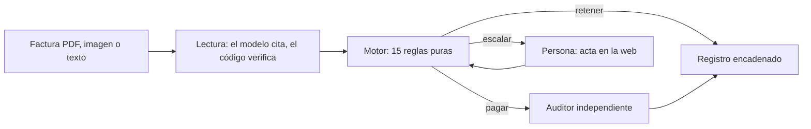

# Custodio

> ### Para el jurado · For the judges
>
> **Guía con cada prueba a un clic · Guide with every proof one click away: <https://blinka-keeper.vercel.app/jurado>**
> ([versión en texto · text version](docs/JUDGE-GUIDE.md))
>
> **Recorrido de 2 minutos · 2-minute walkthrough:** (1) [/panel](https://blinka-keeper.vercel.app/panel): «Decidir
> las facturas» · decide the batch; (2) [acta F-004](https://blinka-keeper.vercel.app/panel?acta=F-004): 15 reglas y
> pago verificado en Stripe · 15 rules and a payment checked live in Stripe; (3) [/reto](https://blinka-keeper.vercel.app/reto):
> engáñalo · try to fool it; (4) [/reglas](https://blinka-keeper.vercel.app/reglas): reglas en español, simuladas ·
> rules in plain Spanish, simulated; (5) [/verificar](https://blinka-keeper.vercel.app/verificar): un recibo alterado
> no pasa · a tampered receipt fails.
>
> - **Impacto 30 % · Impact:** paga sola lo que cabe en las reglas, retiene lo indebido, pide permiso en lo demás; pagos reales en Stripe modo prueba · pays what fits, holds what is improper, asks about the rest; real Stripe test-mode payments.
> - **Innovación 20 % · Innovation:** el modelo lee, 15 reglas en código deciden, doble lectura, reglas en español · the model reads, 15 coded rules decide, double reading, rules in plain Spanish.
> - **Viabilidad técnica 20 % · Technical:** reto público, recibos Ed25519, registro encadenado, 0 pagos indebidos medidos · public challenge, Ed25519 receipts, hash-chained ledger, 0 improper payments measured.
> - **Implementación 20 % · Implementation:** `/empezar`, archivo pain.001 para Blinka, WhatsApp, autohospedable; lo no medido dice «NO MEDIDO» · onboarding, pain.001 for Blinka, WhatsApp, self-hostable; unmeasured is marked as such.
> - **Presentación 10 % · Presentation:** cada afirmación con su prueba y una tabla real vs. simulado · every claim with its proof and a real-vs-simulated table.

[](https://github.com/davidleonb27/blinka-keeper/actions/workflows/ci.yml)
[](LICENSE)

**El agente de cuentas por pagar de código abierto.** *El modelo lee, el código decide, la persona autoriza.*
Revisa las facturas, paga sólo lo que cabe en tus reglas, retiene lo indebido y le pregunta a una persona lo demás.

- **Demo:** <https://blinka-keeper.vercel.app>, sin registro y sin dinero real.
- **Autoalojar en un comando:** `docker compose up --build` ([guía](docs/SELF_HOSTING.md)) o
  [](https://vercel.com/new/clone?repository-url=https%3A%2F%2Fgithub.com%2Fdavidleonb27%2Fcustodio-blinka&project-name=custodio&repository-name=custodio&stores=%5B%7B%22type%22%3A%22integration%22%2C%22integrationSlug%22%3A%22neon%22%2C%22productSlug%22%3A%22neon%22%2C%22protocol%22%3A%22storage%22%7D%5D)
- **Licencia:** [MIT](LICENSE). Documentación en [/docs](https://blinka-keeper.vercel.app/docs).

**The open-source accounts-payable agent.** *The model reads, code decides, a person authorizes.*
It reviews invoices, pays only what fits your rules, holds what is clearly improper and asks a person about the rest.

- **Demo:** <https://blinka-keeper.vercel.app>, no sign-up, no real money.
- **Self-host in one command:** `docker compose up --build` ([guide, in Spanish](docs/SELF_HOSTING.md)) or the
  Vercel button above.
- **License:** [MIT](LICENSE).

## Pruébalo en 30 segundos

1. Abre **https://blinka-keeper.vercel.app** y pulsa **«Probar la demo»**. No hay registro: recibes tu propio espacio.
2. En el panel verás una semana de facturas ya decidida: pagado, retenido y pendiente, cada una con su razón.
3. Abre cualquier fila para ver el acta con las 15 reglas. Prueba «Róbale a Custodio» e intenta que pague algo indebido.

Es dinero de prueba: lo que Custodio paga sale como una transferencia de Stripe en modo prueba, sin cuentas reales.

<!-- Captura: docs/img/demo.gif (ver docs/img/LEEME.md) -->
> *Aquí va el GIF de la demo (`docs/img/demo.gif`), pendiente de grabar sobre la versión desplegada.*

## Por qué existe

El fraude de pagos a proveedores suele ser una factura normal con un dato cambiado: la cuenta bancaria, el número o el
monto. En Estados Unidos, el FBI recibió 24.768 denuncias de compromiso de correo empresarial (BEC) en 2025, con
pérdidas reportadas de US$ 3.046.598.558
([Informe IC3 2025](https://www.ic3.gov/AnnualReport/Reports/2025_IC3Report.pdf)). El 74 % de las organizaciones
encuestadas por la AFP dijo haberlo sufrido ese año
([AFP, abril de 2026](https://www.financialprofessionals.org/about/learn-more/press-releases/Details/over-75-percent-of-us-firms-experienced-payments-fraud-in-2025-while-ai-adoption-for-fraud-mitigation-lags)).
No encontramos una cifra comparable y medida para pymes de América Latina; el detalle está en
[`docs/BUSINESS.md`](docs/BUSINESS.md).

Un agente de IA que lee facturas y paga es el objetivo ideal de ese fraude: una instrucción escondida en el PDF puede
convencerlo. Por eso en Custodio el modelo sólo lee y cita; quien decide es código determinista.

## Cómo cumple el reto

| Criterio de Blinka | Cómo lo cumple Custodio |
|---|---|
| **Autonomía** | 15 reglas deterministas pagan o retienen solas lo que está claro; sólo lo ambiguo va a una persona. |
| **Seguridad** (un pago indebido descalifica) | El modelo nunca decide. Un auditor independiente recalcula cada pago por otro camino de código y, si discrepa, gana el auditor. Hay red team y un reto público. |
| **Explicabilidad** | Cada decisión trae las 15 reglas con sus cifras, un contrafactual («se habría pagado si…») y un registro con hashes verificable. |

## Métricas

Sólo se publican cifras medidas, todas el 2026-10-17. Lo que no se midió dice NO MEDIDO. El detalle y los comandos están
en [`docs/DATASET.md`](docs/DATASET.md) y [`docs/MEASUREMENTS.md`](docs/MEASUREMENTS.md).

| Métrica | Valor | Cómo se midió (2026-10-17) |
|---|---|---|
| Autonomía | 61,1 % (17 pagadas solas + 5 retenidas, de 36) | dataset dorado en producción: espacio demo, `metrics.autonomy_rate` |
| Pendientes de una persona | 14 de 36 | mismo espacio demo en producción |
| Exactitud sobre el dataset etiquetado | 1,0 | mismo espacio demo: decisión del motor frente a `expected` |
| Pagos indebidos según el auditor (producción) | 0 de 36 facturas | mismo espacio demo: `improper_payments` |
| Pagos indebidos en el estrés | 0 (8.136 pagos re-auditados) | `scripts/stress.py --companies 1000 --seed 7`: 1.000 empresas simuladas, 25.139 facturas |
| Latencia del narrador | 4,2 s (N=1, sin intervalo) | una llamada real a Claude en producción |
| Latencia del compilador de políticas | 6,0 s (N=1, sin intervalo) | una llamada real a Claude en producción |
| Lectura de facturas con el modelo real | 36 de 36 con proveedor, monto, moneda y cuenta correctos; 0 rechazos | `apps/api/scripts/measure_reading.py` contra producción, una corrida ([detalle](docs/MEASUREMENTS.md)) |
| Ataques probados del red team | NO MEDIDO | rondas de Claude contra las reglas |
| Intentos del reto público | NO MEDIDO | contador en vivo de «Róbale a Custodio» |
| Decisiones con acta | NO MEDIDO | actas / decisiones |
| Cadena de hashes verificable | NO MEDIDO | `GET /api/v1/ledger/verify` |

## Lo que lo hace distinto

1. **Firewall de pagos para cualquier agente.** Otro agente (de Blinka, de Claude, de un ERP) envía una intención de pago
   por API o MCP y recibe pagar, retener o escalar, con su acta.
2. **Claude contra Claude.** Un atacante con Claude Opus escribe facturas fraudulentas contra las reglas de la empresa,
   lee por qué lo bloquearon y cambia de técnica. El defensor no cambia: las reglas son código.
3. **«Róbale a Custodio».** Página pública donde cualquiera intenta que pague algo indebido. Contador en vivo de
   intentos y de pagos indebidos. Cada ataque atrapado se vuelve un caso de prueba.
4. **Reglas en español, compiladas y simuladas.** «Nada sobre 3.000 USD sin que lo apruebe Ana» se compila a la
   política, se muestra el cambio y se simula contra el historial antes de aplicarlo. Lo que no se entiende se pregunta.
5. **Onboarding de una pregunta por pantalla.** Con el nombre y el sitio web, Claude propone el perfil de la empresa y
   unas reglas iniciales; se importan los proveedores y se simula la primera semana.
6. **Prueba, no promesa.** Tests de propiedades con empresas y lotes aleatorios en cada commit, una prueba de estrés
   reproducible de 1.000 empresas (`docs/DATASET.md`) y un botón «alterar el registro» que muestra dónde se rompe la
   cadena.
7. **Aprobar en un clic.** Lo dudoso queda pendiente en el acta web, donde la persona aprueba o rechaza.

## Arquitectura



Detalle y recorrido completo de una factura en [`docs/ARCHITECTURE.md`](docs/ARCHITECTURE.md). Las decisiones de diseño
están en [`docs/DESIGN.md`](docs/DESIGN.md).

## Autoalójalo

Custodio corre en tu infraestructura con un comando. Todas las variables son opcionales y están explicadas en
[`.env.example`](.env.example).

```bash
git clone https://github.com/davidleonb27/blinka-keeper.git && cd custodio-blinka
docker compose up --build            # Postgres 16, API en :8000 y web en :3000; migraciones al arrancar
curl http://localhost:8000/api/v1/health
```

Sin `ANTHROPIC_API_KEY` siguen funcionando el motor, el auditor, el registro, el firewall por API y MCP, y la lectura de
texto y de PDF con texto (por etiquetas `Campo: valor`). Lo que necesita al modelo responde «requiere
ANTHROPIC_API_KEY» (503, `model_not_configured`) sin decidir nada.

- **Vercel + Neon:** [](https://vercel.com/new/clone?repository-url=https%3A%2F%2Fgithub.com%2Fdavidleonb27%2Fcustodio-blinka&project-name=custodio&repository-name=custodio&stores=%5B%7B%22type%22%3A%22integration%22%2C%22integrationSlug%22%3A%22neon%22%2C%22productSlug%22%3A%22neon%22%2C%22protocol%22%3A%22storage%22%7D%5D) clona el repositorio, crea la base
  en Neon y despliega la web y la API como servicios de un proyecto.
- **Railway, Fly.io o un VPS:** los mismos Dockerfiles; los pasos están en [`docs/SELF_HOSTING.md`](docs/SELF_HOSTING.md).

## Correrlo en local para desarrollar

Requisitos: Python 3.12 con [uv](https://docs.astral.sh/uv/) y Node.js 24.

```bash
./scripts/check.sh                                   # compuerta única: lint, tipos, tests (api y web)
cd apps/api && uv run uvicorn main:app --reload      # API en http://127.0.0.1:8000/api/v1
cd apps/web && npm ci && API_INTERNAL_URL=http://127.0.0.1:8000 npm run dev   # web en http://localhost:3000
```

Los tests con modelo se omiten salvo que se corran con `CUSTODIO_LIVE_TESTS=1`. Cómo contribuir:
[`CONTRIBUTING.md`](CONTRIBUTING.md).

## Firewall y MCP para otros agentes

Cada espacio tiene una API key (pantalla «Desarrolladores»). Con ella, cualquier agente pide una decisión:

```bash
curl -X POST "$CUSTODIO_URL/api/v1/firewall/intents" \
  -H "Authorization: Bearer $CUSTODIO_API_KEY" -H "Content-Type: application/json" \
  -d '{"agent": "mi-agente", "beneficiary_name": "Pulso Software Inc.", "bank_name": "Mercury",
       "account_number": "2214-1180", "amount": 840, "currency": "USD", "invoice_number": "PS-90001"}'
```

La respuesta trae `decision` (con `agent_verdict`: `pay`, `hold` o `escalate`, y las 15 reglas), `ledger_hash` y
`acta_url`.

Para Claude Desktop u otro cliente MCP, apunta al servidor `…/api/v1/mcp`. Herramientas: `submit_payment_intent`,
`get_decision` y `get_policy`. Las dos entradas pasan por las mismas reglas que una factura subida a mano.

## Cómo paga

Custodio decide; el riel paga. Hoy: Stripe en modo prueba. En producción: el riel de la empresa, por ejemplo Blinka
(ACH, wire, Bre-B, SPEI, Pix). Cuando una factura queda pagada desde el panel y el auditor no la vetó, el pago sale por
el riel activo y su recibo queda en el acta y en el registro. Por defecto el riel es simulado; con
`CUSTODIO_PAYMENT_RAIL=stripe_test` y una `STRIPE_SECRET_KEY` de prueba (`sk_test_…`) sale como una transferencia real
de Stripe en modo prueba. Una clave `live` se rechaza. Con `CUSTODIO_PAYMENT_RAIL=blinka_simulated`, Custodio elige la
red de Blinka (ACH, wire, Bre-B, SPEI o Pix) y arma la instrucción exacta que le enviaría, sin enviarla: Blinka aún no
tiene API pública. El firewall, el reto y el red team nunca pagan. Los rieles, sus guardias y la idempotencia están en
[`docs/PAYMENTS.md`](docs/PAYMENTS.md#los-rieles).

**Para el equipo de Blinka:** qué resuelve Custodio en sus clientes, cómo se integra en 2 semanas, el precio propuesto
y lo que falta para producción, en [`docs/BLINKA.md`](docs/BLINKA.md).

## Dataset

Empresa demo y facturas con trampa etiquetadas, publicadas y reproducibles: [`docs/DATASET.md`](docs/DATASET.md).

## Equipo

**DreamMakers**: Adriano Joao Souza Reyna, Juan David Leon y Leober Ramos. Hackathon 30X, Reto Blinka.

## Licencia

[MIT](LICENSE), a nombre de DreamMakers (Adriano Joao Souza Reyna, Juan David Leon y Leober Ramos). Contribuciones bienvenidas: lee [`CONTRIBUTING.md`](CONTRIBUTING.md) y, para reportar una
vulnerabilidad en privado, [`SECURITY.md`](SECURITY.md).

## English summary

Custodio is an accounts-payable agent that cannot be tricked into paying. A model reads each invoice and must quote
the text behind every value; deterministic code (12 pure rules) decides pay, hold or escalate; a person authorizes what
is ambiguous. An independent auditor recomputes every payment through a different code path and overrides the engine if
they disagree. Every decision ships with a plain-language record and a SHA-256 hash chain that shows where it was
altered. Other agents can use Custodio as a payment firewall through an API or an MCP server, and anyone can try to
break it on the public "Róbale a Custodio" challenge. Try it: **https://blinka-keeper.vercel.app**. Figures are published only when
measured (2026-10-17: 36 golden invoices in production, 0 improper payments, 61.1 % autonomy; 1,000 simulated companies
and 25,139 invoices in the stress run, 0 improper payments); the rest reads NO MEDIDO ("not measured"). Built by team DreamMakers for the 30X hackathon, Blinka
challenge. MIT licensed.
