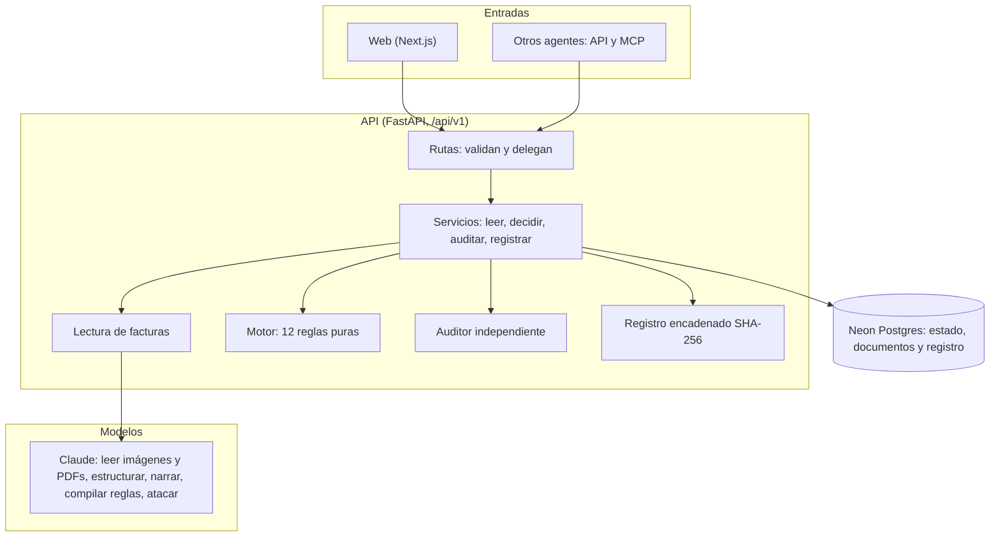

# Arquitectura

Un proyecto en Vercel con dos servicios: la web (Next.js) y la API (FastAPI), sobre Neon Postgres. Claude estructura,
lee imágenes y PDFs escaneados, narra, compila reglas, perfila empresas y ataca. **Ninguno decide un pago.**

Las dependencias apuntan hacia adentro: rutas → servicios → motor puro. El motor no importa nada de red, base de datos,
reloj ni modelos.

## Piezas

| Pieza | Responsabilidad | Dónde |
|---|---|---|
| Contratos | modelos compartidos entre piezas (Pydantic) | `apps/api/custodio/contracts.py` |
| Puerta al modelo | única vía a Claude: salida estructurada, caché, tope diario de gasto | `apps/api/custodio/llm.py` |
| Motor | reglas R1–R12, decisión por lote, simulación, contrafactual, explicación | `apps/api/custodio/engine/` |
| Auditor | recalcula cada pago por otro camino de código; si discrepa, gana él | `apps/api/custodio/engine/audit.py` |
| Registro | cadena SHA-256; `verify()` dice en qué entrada se rompió | `apps/api/custodio/engine/ledger.py` |
| Lectura | PDF, imágenes, texto oculto, estructuración y verificación de citas | `apps/api/custodio/extraction/` |
| IA | compilador de reglas, narración, perfil, importación, red team | `apps/api/custodio/ai/` |
| API | rutas, persistencia, aprobaciones, firewall, MCP, reto público | `apps/api/custodio/api/`, `db/` |
| Web | panel, acta, onboarding, reglas, arena, reto, registro, desarrolladores | `apps/web/` |

## Recorrido de una factura

Una factura PDF con la cuenta cambiada, de punta a punta:

1. **Llega.** Una persona la sube desde la web, o un agente envía una intención de pago por API o MCP. El archivo se
   guarda (hasta 4 MB) y se anota en el registro.
2. **Se extrae el texto.** `pdfplumber` lee el texto visible por carácter con su color, tamaño y posición. Un PDF sin
   texto o una imagen los lee Claude con visión.
3. **Se busca texto escondido.** Texto del color del fondo, de menos de 2 pt, fuera de la página, tapado o en metadatos
   queda como hallazgo. Eso activa R2: escalar, sin importar qué diga el texto.
4. **El modelo estructura.** Claude devuelve proveedor, NIT, número, fechas, monto, moneda y cuenta, y por cada campo la
   cita exacta del documento.
5. **El código verifica las citas.** La cita debe existir en el texto fuente y respaldar el valor (el monto citado da el
   mismo número). Si no, el campo queda `verified = false` y cuenta como no leído (R1).
6. **El motor evalúa las 12 reglas.** En orden, con cifras concretas en cada razón. En el ejemplo, R4 falla: la cuenta
   leída no es la registrada del proveedor. Es una regla de retener.
7. **Se decide el veredicto.** Si falla alguna regla de retener, se retiene; si no, si falla alguna de escalar, queda
   pendiente de aprobación; si no, se paga y se descuenta del saldo y del cupo. Aquí: **retener**.
8. **El auditor recalcula.** Con código distinto al del motor revisa cada pago. Si un pago no pasa, no se hace y cuenta
   como pago indebido. En el ejemplo no hay pago que revisar.
9. **Se escribe el acta.** Explicación en español, contrafactual («se habría pagado si la cuenta nueva se verificara con
   el proveedor y se registrara») y, opcionalmente, una narración del modelo en la que se valida cada número.
10. **Se registra.** La decisión entra al registro con su hash: `sha256(hash_anterior + json_canónico(entrada))`.
11. **La persona ve y decide lo dudoso.** Si el veredicto fuera «escalar», el acta queda en el panel para que la persona decida; aprobar
    se aplica después del lote y sólo paga si el saldo sigue por encima de la reserva.
12. **Se puede comprobar.** `GET /api/v1/ledger/verify` revisa la cadena; «alterar una copia» muestra cómo se rompe sin
    tocar el registro real.

## Invariantes que hace cumplir un test

- El motor es puro: sin red, sin reloj, sin azar, sin modelo.
- Ningún pago ocurre con una regla de retención fallida ni deja el saldo bajo la reserva, ni siquiera con aprobación.
- El motor nunca lee `expected` ni `trap`.
- Ningún texto de un documento cambia una regla ni autoriza nada.
- Un valor sin cita verificada por código cuenta como no leído.
- Si el auditor discrepa, el pago no se hace.

La lista completa y la especificación de cada pieza están en [`DESIGN.md`](DESIGN.md).

## Despliegue y secretos

`vercel.json` declara dos servicios, `web` y `api`, y reenvía `/api/v1/*` a la API. Las claves (`ANTHROPIC_API_KEY` y
`DATABASE_URL`) viven sólo en variables de entorno; no se escriben en logs,
errores, prompts ni respuestas. Las rutas que llaman modelos tienen límite por IP y por espacio, y el gasto en modelos
tiene un tope diario.
